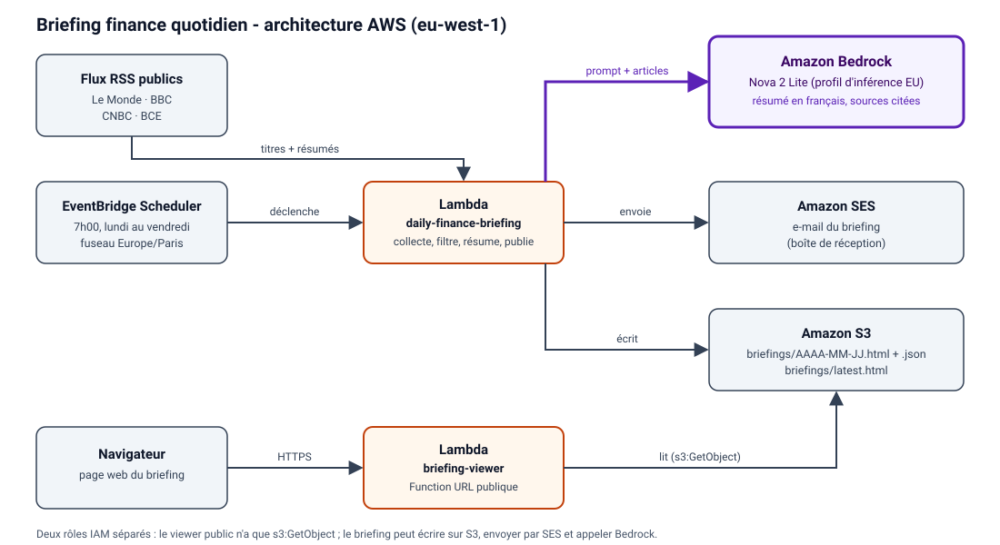
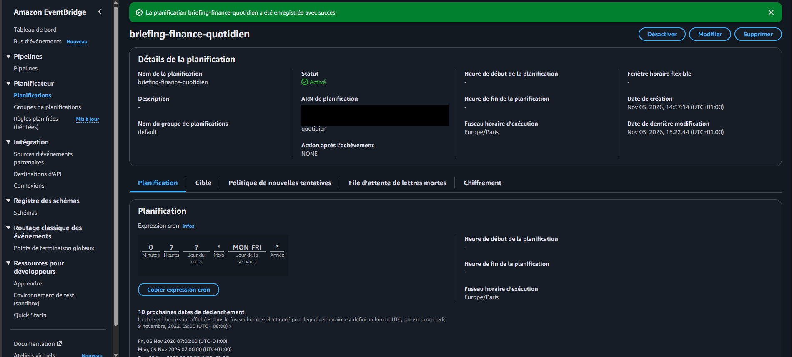
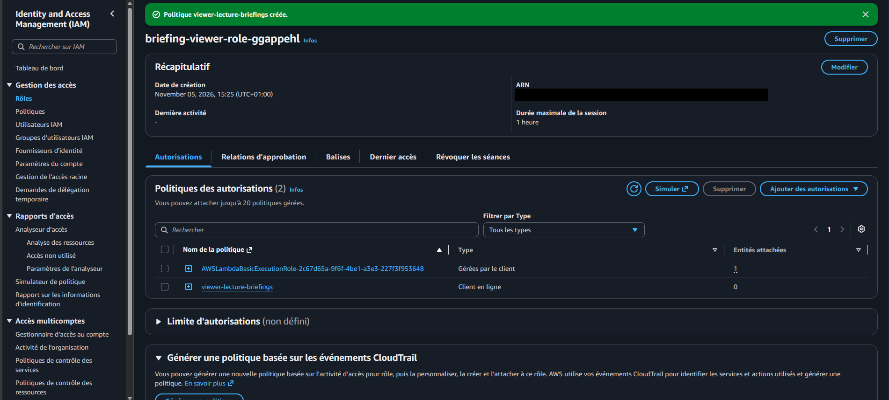
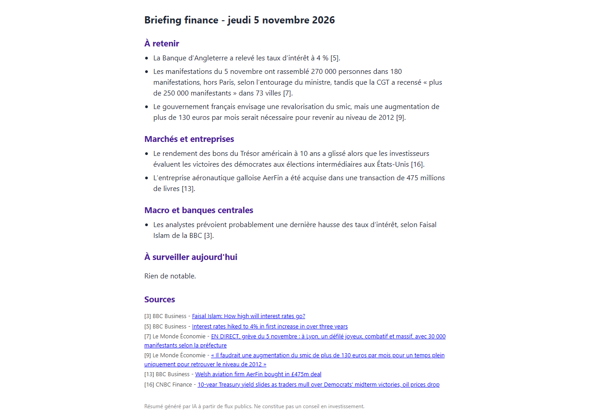
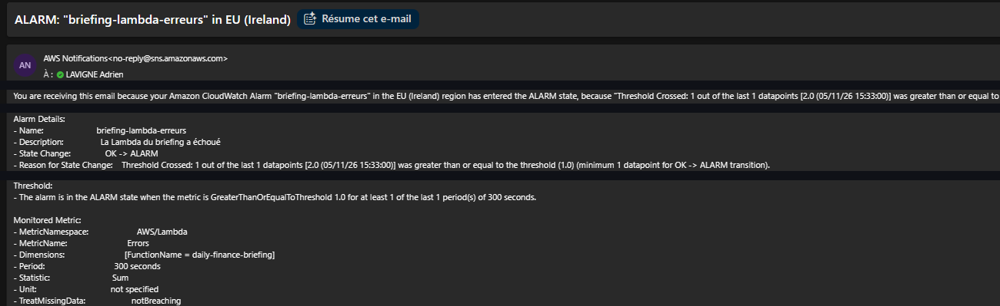
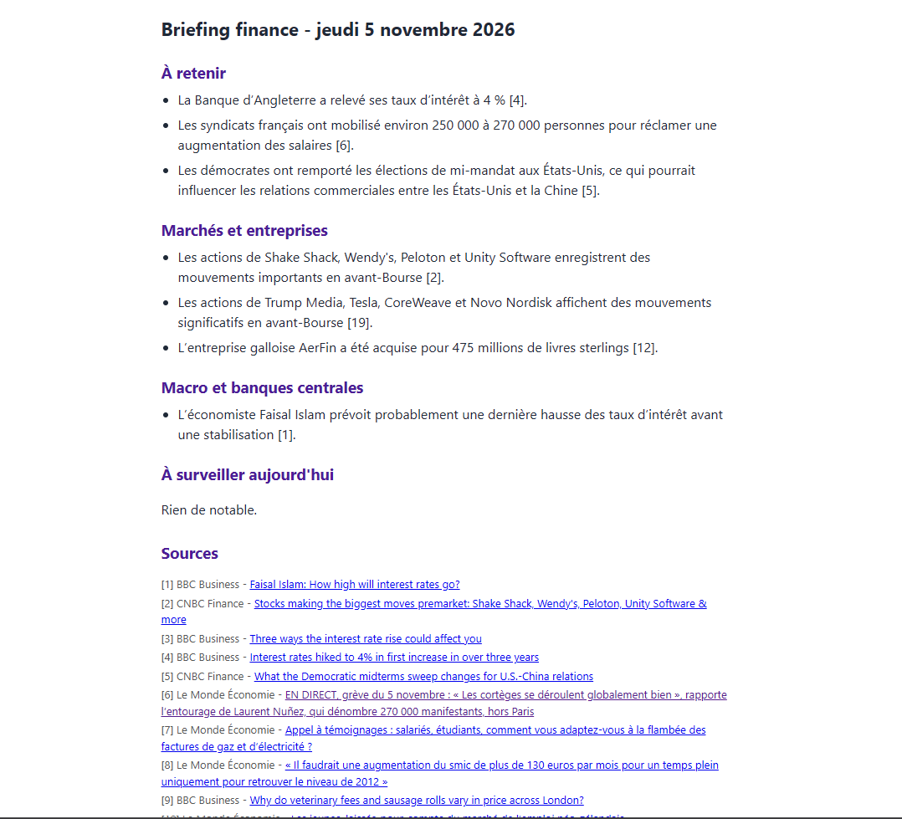
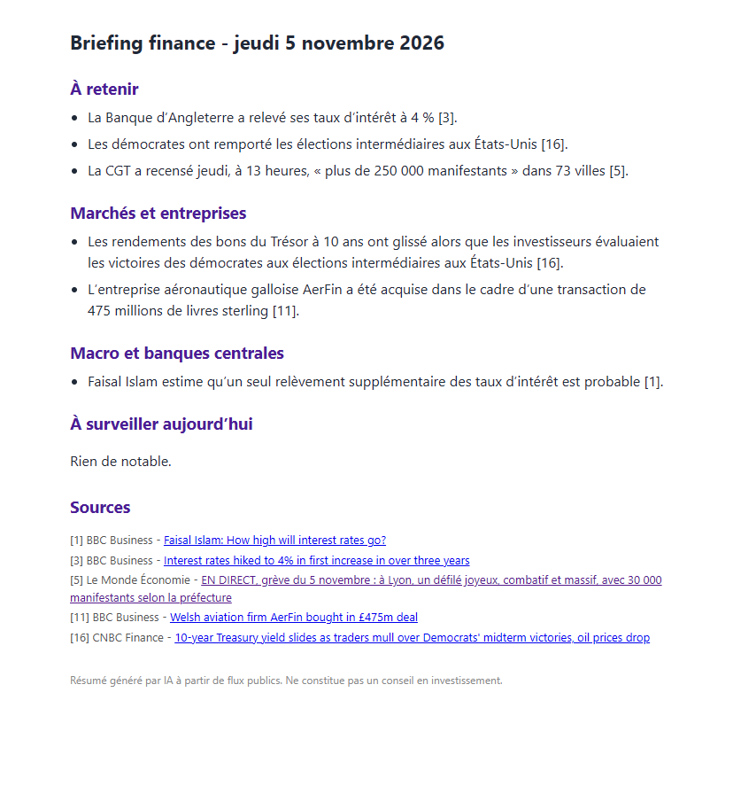

# Briefing finance quotidien - guide console AWS

Chaque matin en semaine, un e-mail résume l'actualité financière (flux RSS publics, résumé par Amazon Bedrock, sources citées). La dernière version est aussi consultable sur une page web.

Comment ça marche :
1. **EventBridge Scheduler** déclenche la Lambda `daily-finance-briefing` à 7h00 (Europe/Paris), du lundi au vendredi.
2. La Lambda lit les flux RSS publics (bibliothèque standard), écarte les articles sans information, puis demande à **Amazon Bedrock** (Nova 2 Lite, profil d'inférence EU) un résumé en français avec sources citées.
3. Elle écrit la page dans **S3** (`briefings/`) et envoie l'e-mail via **SES**, avec un lien vers la page web.
4. La Lambda `briefing-viewer` (Function URL, rôle IAM minimal en lecture S3) sert le dernier briefing.
5. **CloudWatch** surveille les erreurs de la Lambda et prévient par e-mail via **SNS**. **Budgets** surveille les coûts.

**Région à utiliser partout : Europe (Irlande) `eu-west-1`.** (Bedrock, SES et le profil d'inférence `eu.` y sont disponibles ; vérifie que la région affichée en haut à droite de la console reste la même à chaque étape.)

Les étapes 1 à 7 donnent un briefing fonctionnel.

---

## Étape 1 - Sécuriser le compte
1. Connecte-toi en root, **active la MFA** (menu du compte > Security credentials > Assign MFA device).
2. **AWS Budgets** > Create budget > *Customize (advanced)* > Cost budget > mensuel, montant **10 USD**, alerte à 80 % vers ton e-mail. *(Activité « budget » du widget Explore AWS.)*
3. Pour travailler au quotidien, crée un utilisateur **IAM Identity Center** ou IAM avec droits admin et ne te sers plus du root. (Si tu bloques ici, garde le root pour aujourd'hui avec la MFA, et note-le comme dette à corriger.)

## Étape 2 - Bucket S3
S3 > Create bucket > nom unique, par exemple `briefing-finance-adrien-2026` > région eu-west-1 > **laisse « Block all public access » coché**. Note le nom exact.

## Étape 3 - Vérifier ton e-mail dans SES
Amazon SES > Identities > Create identity > *Email address* > ton adresse > clique le lien reçu par e-mail. Le compte SES est en **sandbox** : expéditeur et destinataire doivent être vérifiés. Utilise la même adresse pour les deux.

## Étape 4 - Tester Bedrock dans le playground
Bedrock > Playgrounds > Chat > Select model > Amazon > **EU Amazon Nova 2 Lite** > envoie « Résume en une phrase ce qu'est la volatilité ». *(Activité « Bedrock » du widget Explore AWS.)*
Ensuite : Bedrock > *Cross-region inference* (ou Inference profiles) : repère l'identifiant du profil **EU de Nova 2 Lite** (`eu.amazon.nova-2-lite-v1:0`). Si le nom diffère, tu le mettras dans la variable `MODEL_ID` à l'étape 5.

> **Compte neuf :** Bedrock peut répondre `AccessDeniedException ... account is currently being verified`. La vérification prend normalement moins de 2 heures. En attendant, teste la Lambda avec `{"no_ai": true}` (étape 6) : elle n'appelle pas Bedrock.

## Étape 5 - Lambda du briefing
1. Lambda > Create function > *Author from scratch* > nom `daily-finance-briefing` > Runtime **Python 3.12** > *Create a new role with basic Lambda permissions*.
2. Onglet Code : remplace le contenu de `lambda_function.py` par le fichier fourni > **Deploy**.
3. Configuration > General configuration > Edit : **Timeout 1 min 30**, mémoire **256 Mo**.
4. Configuration > Environment variables : `BUCKET`, `SENDER`, `RECIPIENT`, et `MODEL_ID` si besoin.
5. Configuration > Permissions > clique le nom du rôle > Add permissions > Create inline policy > onglet JSON > colle `iam-policy.json` **en remplaçant le nom du bucket** > nom `briefing-policy`.

## Étape 6 - Premier test sans e-mail
Onglet Test > événement `{"dry_run": true}` > Test. Pour tester sans Bedrock : `{"dry_run": true, "no_ai": true}`. Attendu : `"status": "ok"` et un nombre d'articles. Ouvre S3 > `briefings/latest.html` pour voir le résultat. En cas d'erreur : CloudWatch > Log groups > `/aws/lambda/daily-finance-briefing`.
Erreurs courantes :
- `AccessDeniedException` sur Bedrock : modèle non autorisé ou `MODEL_ID` incorrect (voir étape 4).
- `Flux ignoré` dans les logs : un flux RSS ne répond pas, ce n'est pas bloquant tant qu'il en reste un.

## Étape 7 - Vrai test avec e-mail
Relance le test avec `{}`. Tu dois recevoir l'e-mail (regarde les spams).

Note : Outlook affiche « Non vérifié » car l'expéditeur est une adresse e-mail vérifiée dans SES et non un domaine à soi (SPF/DKIM alignés). Le message arrive bien en boîte de réception ; avec un domaine personnel, l'avertissement disparaîtrait.

## Étape 8 - Planification
EventBridge > Scheduler > Create schedule > *Recurring* > *Cron-based* : `0 7 ? * MON-FRI *` > fuseau **Europe/Paris** > cible *AWS Lambda* > `daily-finance-briefing` > laisse créer le rôle d'exécution. Pour tester sans attendre, mets temporairement une heure dans 5 minutes.

Attention : dans le champ cron, une des deux cases « jour » doit valoir `?` (jour du mois `?` avec `MON-FRI`), sinon l'expression est refusée.

## Étape 9 - Page web publique avec Function URL
1. Lambda > Create function `briefing-viewer` > Python 3.14 > colle `viewer.py` > Deploy > variable `BUCKET`.
2. Ajoute au rôle de cette fonction une politique inline avec seulement `s3:GetObject` sur `arn:aws:s3:::TON-BUCKET/briefings/*` (la fonction est publique : elle ne doit pas réutiliser le rôle du briefing, qui peut envoyer des e-mails et appeler Bedrock).

3. Configuration > Function URL > Create > Auth type **NONE** > Save. Ouvre l'URL : tu vois le dernier briefing. *(Activité « Lambda » du widget Explore AWS.)*
La page est publique : n'y mets rien de privé.

## Étape 10 - Vérifier les crédits et nettoyer
Billing > Credits : contrôle ce qui a été crédité. N'oublie pas de supprimer tout ce que tu crées pour les activités EC2 ou RDS.

---

## Étape 11 - Alerte en cas d'échec (SNS + CloudWatch)
Sans alerte, un briefing qui plante ne se remarque que parce que l'e-mail n'arrive pas.
1. **SNS** > Rubriques > Créer une rubrique, type **Standard**, nom `alertes-briefing`. Crée un abonnement de protocole **E-mail** (adresse de messagerie) vers ton adresse, puis clique sur le lien de confirmation reçu par e-mail (statut **Confirmé**).
2. **CloudWatch** > Alarmes > Créer une alarme > métrique `AWS/Lambda` > `Errors` de `daily-finance-briefing`.
3. Réglages importants : statistique **Somme**, période 5 minutes, seuil statique **supérieur ou égal à 1**, 1 point de données sur 1, données manquantes traitées comme **correct (non violantes)** : la Lambda ne tourne qu'une fois par jour, sans cela l'alarme resterait en « Données insuffisantes ».
4. Action : état **En alarme** > rubrique SNS `alertes-briefing`. Nom : `briefing-lambda-erreurs`.
5. **Test sans rien casser** : dans la Lambda, crée un événement de test `["erreur volontaire"]` (une liste au lieu d'un objet) : la fonction plante, l'alarme passe en rouge et l'e-mail d'alerte arrive en quelques minutes. Relancer un test normal remet l'alarme à OK.

## Qualité du briefing : avant / après
Un petit modèle (Nova 2 Lite) résume bien, mais il faut le cadrer et vérifier ses sorties **contre le texte complet** qu'il a reçu (titre + résumé), pas seulement contre les titres.

| Avant | Après |
|---|---|
|  |  |

Ce qui a changé, dans l'ordre :
- **Filtre en code, avant l'IA** : les articles de type « stocks making the biggest moves » sont écartés, car le modèle ignorait l'instruction négative du prompt (aucune information utile, mais des puces creuses).
- **Chiffres** : le prompt impose de garder leur périmètre et leur origine (« la CGT a recensé… », « hors Paris ») et de donner les deux décomptes quand deux sources divergent.
- **Pas de doublons** entre sections, pas de fonction ni de prévision inventées pour une personne.
- **Sources** : seulement les articles réellement cités.
- Limite connue : les « live » de presse sont réécrits en continu, donc le titre d'une source peut changer entre deux exécutions.

## Coûts attendus
Un briefing = quelques milliers de tokens avec Nova Lite, soit des centimes par mois. Lambda, EventBridge et SES restent dans les offres gratuites à ce volume. Le seul risque est de laisser tourner autre chose (EC2, RDS).

## Pour aller plus loin (v2)
- Remplacer les politiques `Resource: "*"` (Bedrock, SES) par des ressources précises.
- Décrire toute l'infrastructure avec Terraform ou AWS SAM.
- Ajouter une 2e alarme si le briefing ne tourne pas du tout (aucune invocation entre 7h et 8h).
- Brancher le résumé quotidien dans ton portfolio.
- Réutiliser les JSON de `briefings/` comme source pour le projet or.
